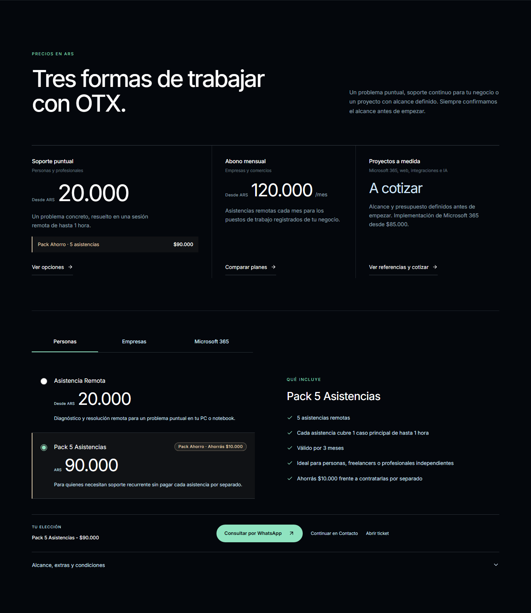
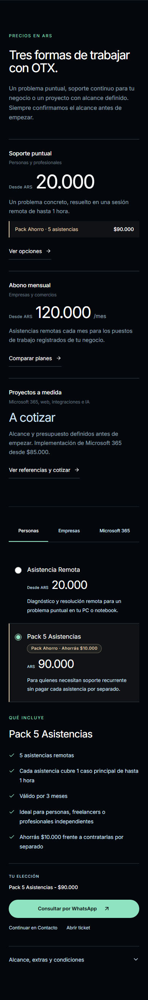

# Evolución de Dirección Artística, Jerarquía Visual y Comunicación Comercial — OTX Solutions

Continuación en la rama `modernizacion-integral-2026-10` (**PR #2**). Sin merge ni despliegue a producción.

## 1. Síntesis de la dirección artística implementada (Estudio Editorial Asimétrico)

Conservando intactos **Header**, **Hero** (`Tecnología sin complicaciones.`), la paleta grafito/hielo/verde/champagne (`#04070C`, `#CFE4F7`, `#8FE3C0`, `#E5D3B3`) y los precios y condiciones vigentes, se evolucionó la arquitectura de **Servicios**, **Automatizaciones** y **Precios** para eliminar la monotonía de acordeones repetidos y dotar a OTX Solutions de identidad de estudio tecnológico:

1. **Manifiesto de posicionamiento (`#servicios`)**:
   - Apertura con espacio negativo intencional y jerarquía tipográfica marcada: **"Primero entendemos cómo trabajás. Después elegimos la tecnología."**
   - Navegación directa hacia los dos grandes frentes comerciales de OTX: `01 Soporte y continuidad` y `02 Optimización y proyectos`.
2. **Capítulo 01 — Soporte y continuidad tecnológica (`#soporte-continuidad`)**:
   - Titular editorial a 8 columnas (**"Cuando algo deja de funcionar, lo resolvemos. A distancia o en el lugar."**) junto a un bloque comercial de acción rápida con CTA principal a WhatsApp, enlaces a Contacto/Tickets y referencias claras de precio (`Asistencia remota desde $20.000`, `Abonos para empresas desde $120.000/mes`).
   - Índice de capacidades en 3 columnas sin obligar a abrir desplegables (*Cuando algo falla*, *Para que no vuelva a pasar*, *Cuando hay que equipar*), donde cada ítem permite prellenar directamente la consulta en Contacto.
3. **Capítulo 02 — Optimización, herramientas y proyectos (`#optimizacion-proyectos`)**:
   - Cambio de ritmo compositivo con titular desplazado a la columna 3: **"¿Estás utilizando las herramientas adecuadas para tu trabajo?"**
   - Secuencia metodológica en 4 pasos (`01 Analizamos herramientas y procesos` → `02 Recomendamos alternativas concretas` → `03 Configuramos e integramos` → `04 Automatizamos cuando corresponde`) y grilla de 6 capacidades (*Microsoft 365*, *Organización de la información*, *Integraciones*, *Automatización de tareas*, *Sitios web y formularios*, *Inteligencia artificial aplicada*).
4. **Demostración visual de Automatización (`#automatizacion`)**:
   - Banda de contraste sutil (`#070B11`) encabezada por **"De horas de trabajo manual a minutos de ejecución."**, aclarando expresamente que el resultado depende de cada proceso y su viabilidad.
   - Comparativa visual en dos carriles (**Hoy — 4 pasos, 3 manuales** vs. **Con un flujo automatizado — El equipo solo revisa y responde**) mostrando mini-artefactos sobrios de interfaz (correo entrante, planilla completada automáticamente, aviso al área responsable y estados `Nueva / Asignada / Respondida`), con leyenda explícita de ejemplo ilustrativo.
5. **Transición editorial hacia Precios (`#planes`)**:
   - Apertura con **"Tres formas de trabajar con OTX."** que diferencia con nitidez:
     - **Soporte puntual** (*Personas y profesionales* — `Desde ARS 20.000` + destaque champagne `Pack Ahorro · 5 asistencias $90.000`).
     - **Abono mensual** (*Empresas y comercios* — `Desde ARS 120.000/mes`).
     - **Proyectos a medida** (*Microsoft 365, web, integraciones e IA* — `A cotizar`, con referencia de implementación Microsoft 365 desde `$85.000`).
   - Conectado directamente con el selector interactivo de planes y condiciones aprobado.

---

## 2. Capturas reales — Escritorio (`1440×900`) y Móvil (`390×844`)

| Sección | Escritorio (`1440×900`) | Móvil (`390×844`) |
| --- | --- | --- |
| **Servicios + Automatización (`#servicios`)** |  |  |
| **Precios y transición de 3 modalidades (`#planes`)** |  |  |
| **Cómo trabajamos (`#como-funciona`)** |  |  |
| **Por qué elegirnos (`#por-que-elegirnos`)** |  |  |
| **Preguntas frecuentes (`#faq`)** |  |  |
| **Contacto (`#contacto`)** |  |  |
| **Tickets (`/ticket`)** |  |  |
| **Footer** |  |  |
