# Revisión Integral de Dirección Artística, Experiencia de Usuario y Credibilidad Comercial — OTX Solutions

Continuación sobre la rama `modernizacion-integral-2026-10` (**PR #2**). Sin merge a `main` ni despliegue a producción.

---

## 1. Síntesis de cambios implementados

Manteniendo intactos **Header**, **Hero** (`Tecnología sin complicaciones.`), la identidad `otx.`, los acentos verde (`#8FE3C0`) y champagne (`#E5D3B3`) y la totalidad de los precios y condiciones vigentes:

1. **Profundidad ambiental y relieve grafito coherente con el Hero (`PremiumOffer.css` & `PremiumSections.css`)**:
   - Se extendió la textura satinada de bajo relieve del Hero (`otx-surface-desktop.webp` / `otx-surface-mobile.webp`, sin peso adicional de red al reutilizar el mismo recurso ya cargado) junto con iluminación ambiental radial controlada, superficies grafito por capas (`#04070C`, `#060B13`, `#070C14`, `#09101B`) y filetes arquitectónicos sutiles entre secciones.
2. **Compactación y jerarquía ponderada en Servicios (`Services.jsx`)**:
   - **Reducción de altura en móvil (`390px`)**: de `6.245 px` a **`4.472 px`** (**`-1.773 px` / `-28%`**). En escritorio (`1440px`), de `4.197 px` a **`2.531 px`** (**`-1.666 px` / `-40%`**).
   - **01 · Soporte y continuidad tecnológica**: el servicio principal (*Soporte técnico para particulares, profesionales y oficinas*, remoto o con visita a coordinar) ocupa una columna destacada con mayor peso visual, acompañado a la derecha por 3 bloques secundarios (*Mantenimiento, seguridad y respaldo*, *Equipamiento, armado y oficinas*, *Soporte mensual para empresas*), eliminando introducciones y precios duplicados.
   - **02 · Optimización, herramientas y proyectos**: encabezado por **"¿Estás utilizando las herramientas adecuadas para tu trabajo?"**, con banda destacada para **Asesoramiento tecnológico y productividad** (reemplazando la denominación genérica de *Capacitación personalizada*) y 3 bloques de proyecto (*Microsoft 365 y entorno empresarial*, *Desarrollo web y formularios*, *Integraciones, automatización e IA*).
3. **Demostración editorial compacta de Automatización (`#automatizacion`)**:
   - Conserva el titular **"De horas de trabajo manual a minutos de ejecución."** aclarando expresamente que depende de cada proceso y su viabilidad técnica.
   - Reemplaza las 8 tarjetas extensas anteriores por un tablero editorial compacto (`623 px` de alto en escritorio, `1.299 px` en móvil) con una tira de flujo en 3 nodos (`Correo o formulario` → `Fila en planilla con fecha y motivo` → `Aviso al responsable asignado`) y 3 columnas concisas (`01 · Problema habitual`, `02 · Qué se automatiza`, `03 · Beneficio concreto`), con aclaración discreta de ejemplo ilustrativo.
4. **Unificación de jerarquía en Precios sin redundancia (`Pricing.jsx`)**:
   - Las 3 modalidades comerciales (`01 Soporte puntual`, `02 Abonos mensuales`, `03 Proyectos y Microsoft 365`) funcionan directamente como tarjetas selectoras interactivas (`<TabsTrigger>`), eliminando la duplicación entre resumen previo y pestañas.
   - **Reducción de altura en Precios**: de `2.632 px` a **`1.730 px`** en móvil (**`-902 px` / `-34%`**) y de `1.664 px` a **`1.029 px`** en escritorio (**`-635 px` / `-38%`**).
   - Todos los precios vigentes en `mock.js` se mantienen intactos:
     - **Personas (`planesParticulares`)**: `Asistencia Remota` (`$20.000`) y `Pack 5 Asistencias` (`$90.000`, con destaque champagne satinado `Pack Ahorro · Ahorrás $10.000` y equivalencia de `$18.000 por asistencia`).
     - **Empresas (`planesPymes`)**: `Empresa Inicial` (`$120.000/mes`, 3 asistencias, hasta 3 puestos), `Empresa Operativa` (`$180.000/mes`, 5 asistencias, hasta 6 puestos) y `Empresa Plus` (`A cotizar`, más de 6 puestos).
     - **Microsoft 365 (`planesM365`)**: `Implementación Inicial` (`Desde $85.000`), `Gestión Mensual` (`Desde $25.000/mes`) y `SharePoint/OneDrive Básico` (`Desde $45.000`).
   - No se utilizan insignias `"Más elegido"` ni etiquetas comerciales sin respaldo.
5. **Eliminación de apariencia ficticia, respaldo por WhatsApp y validación rigurosa en formularios (`Contact.jsx`, `TicketPage.jsx`, `offer-catalog.js`, `backend/routers/tickets.py`)**:
   - Se eliminaron todos los placeholders ficticios (`Juan Pérez`, `juan@email.com`, `11 1234-5678`) y el marcador `[DESCRIBIR BREVEMENTE]`, reemplazándolos por indicaciones neutras y mensajes de WhatsApp generados dinámicamente con los datos reales del formulario (`buildWhatsAppUrl` con `encodeURIComponent`).
   - **Circuito real de tickets (`FastAPI` + `Google Apps Script`)**:
     - `Contact.jsx` (`canal: "Landing"`) y `TicketPage.jsx` (`canal: "TicketWeb"`) envían `POST ${REACT_APP_BACKEND_URL}/api/tickets`.
     - `backend/routers/tickets.py` valida los campos, aplica rate-limit por IP y reenvía la solicitud a `GOOGLE_APPS_SCRIPT_URL` (`backend/google_apps_script.js`), el cual registra el ticket en Google Sheets (`OTX-AA-NNNN`) y envía la notificación por correo mediante `MailApp.sendEmail`. (`MONGO_URL` y `DB_NAME` en `backend/server.py` solo se utilizan en las rutas de plantilla `/api/status`, no en `/api/tickets`).
     - Se eliminó el fallback `ticket_id = "N/A"` y cualquier confirmación ficticia (`"BLOCKED"`): tanto el backend (`is_valid_ticket_id`) como el frontend (`isValidTicketId`) exigen HTTP 2xx, `success: true` y un identificador real válido antes de mostrar la pantalla de confirmación. Si el servicio falla o no está disponible, se conservan todos los datos ingresados por el usuario y se ofrecen accesos directos a WhatsApp y correo con la consulta ya redactada.
   - Se depuró el lenguaje comercial en todo el sitio para eliminar promesas absolutas de velocidad (*"atención inmediata"*, *"en el día"*, *"en el acto"*), comunicando asistencia remota y visitas técnicas coordinadas según disponibilidad.

---

## 2. Comparativa de alturas (Antes vs. Después)

| Sección | Escritorio Antes (`1440px`) | Escritorio Después (`1440px`) | Variación Escritorio | Móvil Antes (`390px`) | Móvil Después (`390px`) | Variación Móvil |
| --- | ---: | ---: | ---: | ---: | ---: | ---: |
| **Servicios + Automatización (`#servicios`)** | `4.197 px` | **`2.531 px`** | **`-1.666 px` (`-40%`)** | `6.245 px` | **`4.472 px`** | **`-1.773 px` (`-28%`)** |
| **Modalidades y precios (`#planes`)** | `1.664 px` | **`1.029 px`** | **`-635 px` (`-38%`)** | `2.632 px` | **`1.730 px`** | **`-902 px` (`-34%`)** |
| **Total combinado (`#servicios` + `#planes`)** | `5.861 px` | **`3.560 px`** | **`-2.301 px` (`-39%`)** | `8.877 px` | **`6.202 px`** | **`-2.675 px` (`-30%`)** |

---

## 3. Capturas reales — Escritorio (`1440×900`) y Móvil (`390×844`)

| Sección | Escritorio (`1440×900`) | Móvil (`390×844`) |
| --- | --- | --- |
| **Servicios (`#servicios`)** | 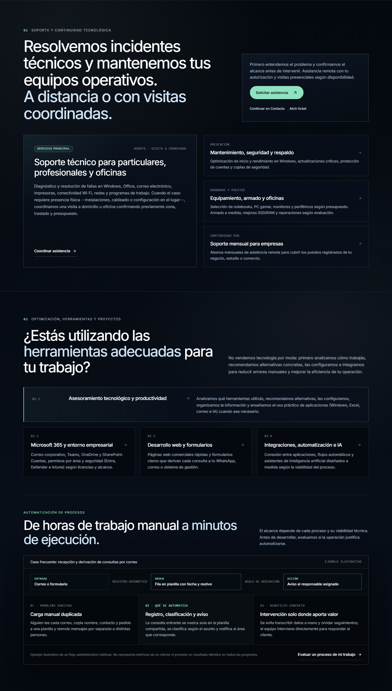 | 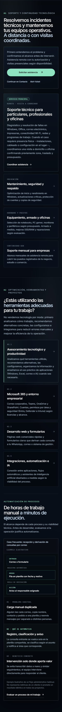 |
| **Tablero de Automatización (`#automatizacion`)** | 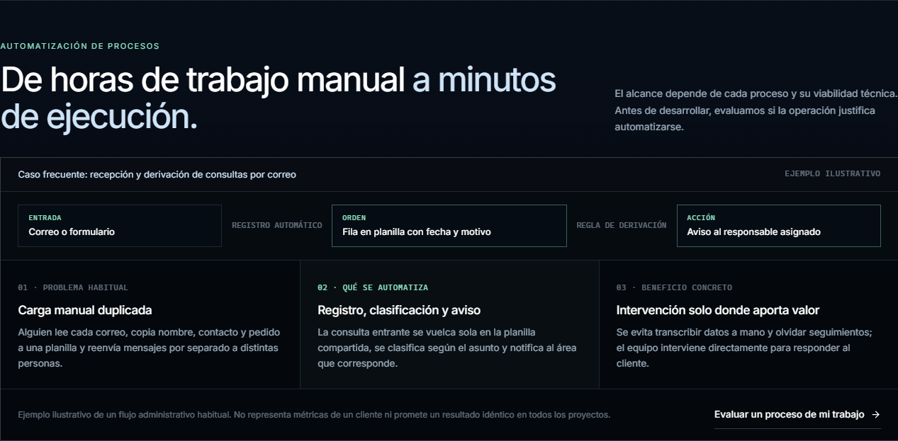 | 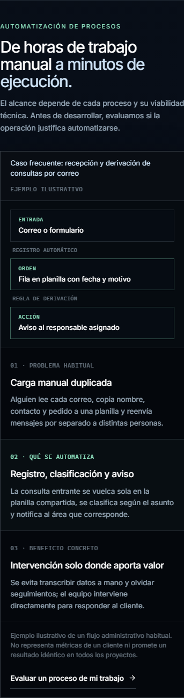 |
| **Modalidades y precios (`#planes`)** | 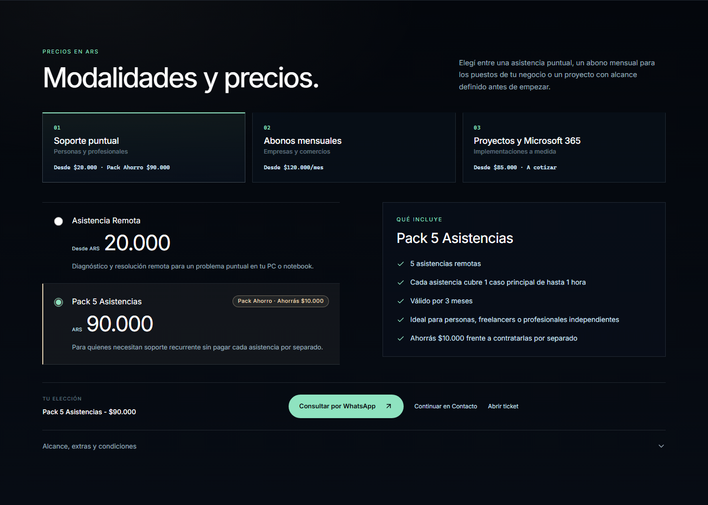 | 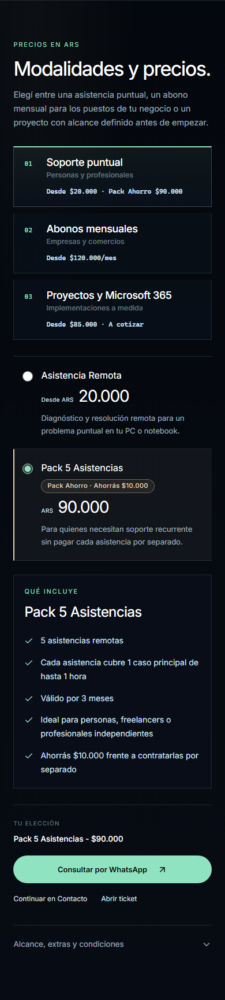 |
| **Cómo trabajamos (`#como-funciona`)** | 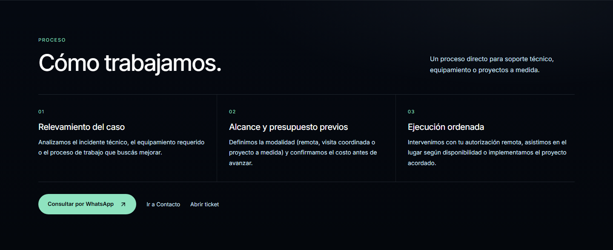 | 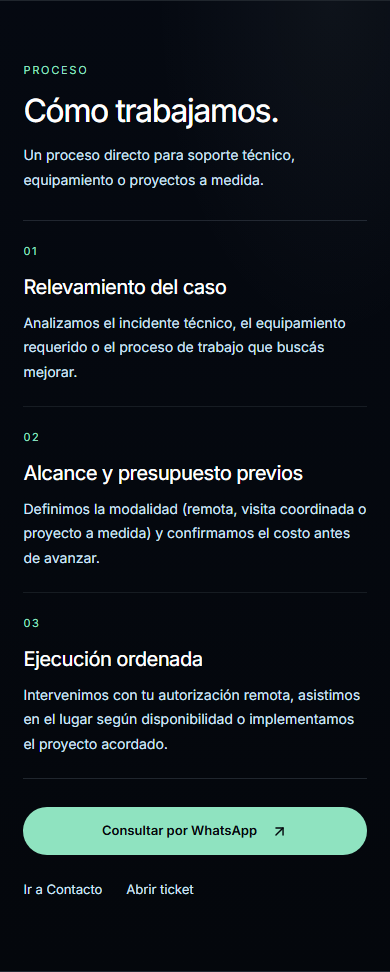 |
| **Por qué elegirnos (`#por-que-elegirnos`)** | 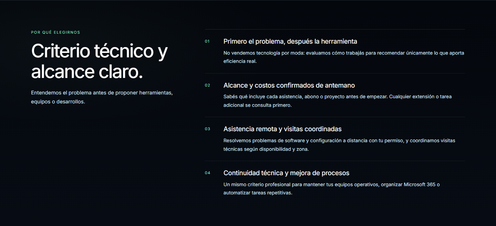 | 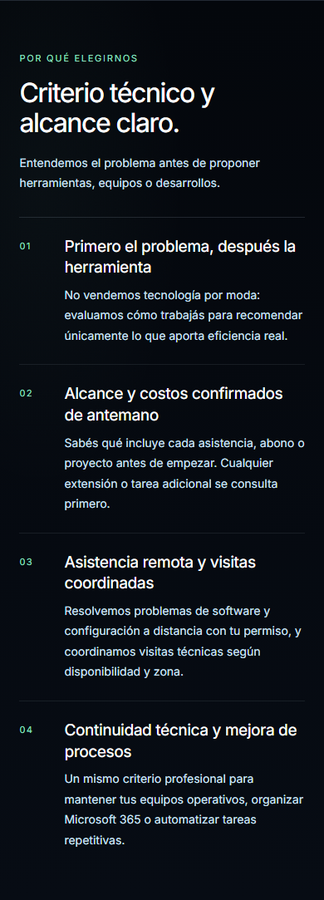 |
| **Preguntas frecuentes (`#faq`)** | 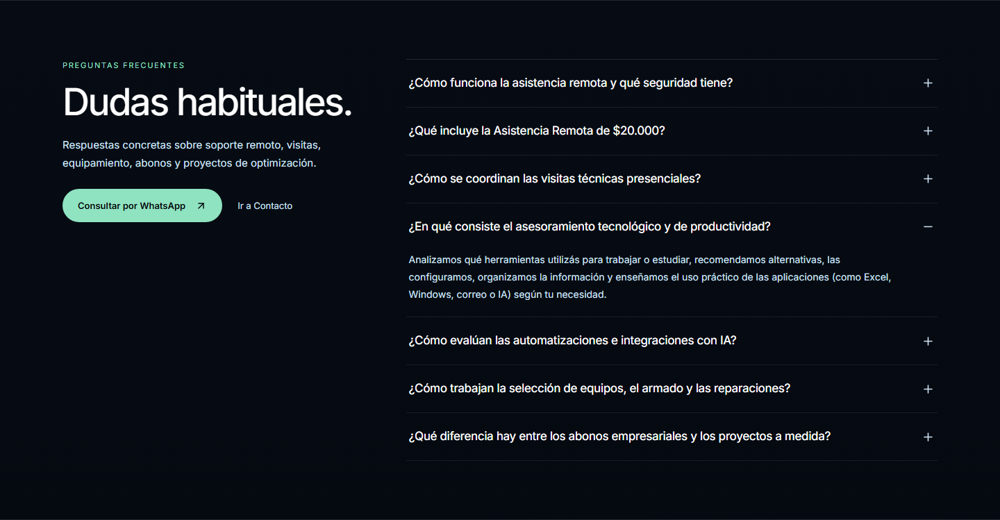 | 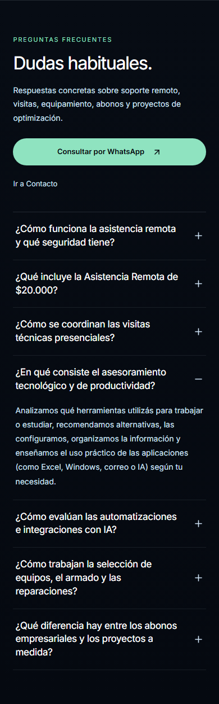 |
| **Contacto (`#contacto`)** | 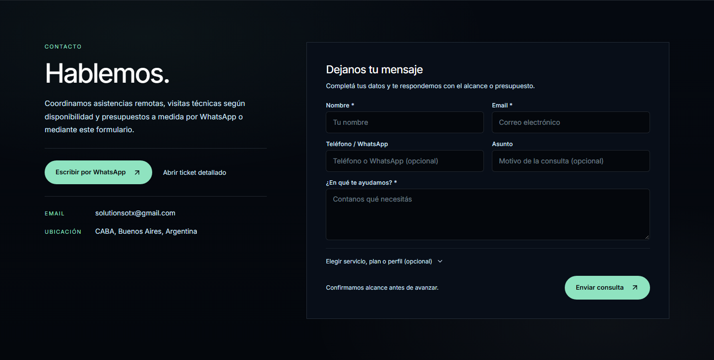 | 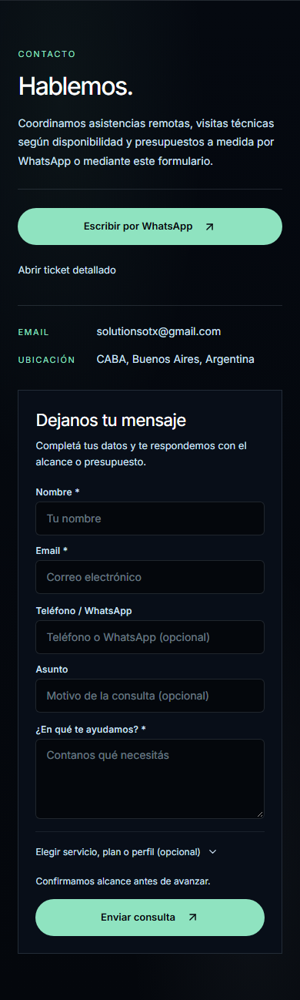 |
| **Tickets (`/ticket`)** | 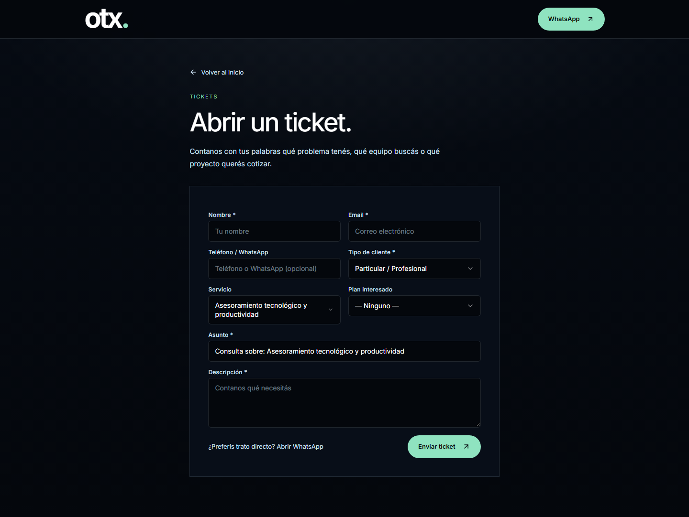 | 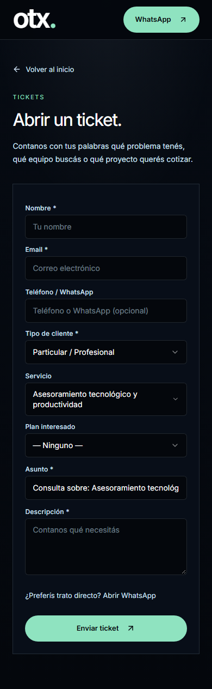 |
| **Footer** | 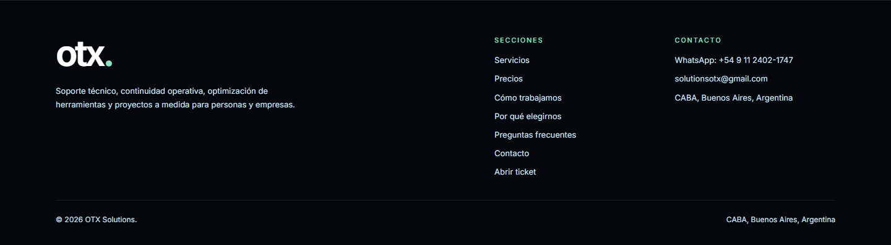 | 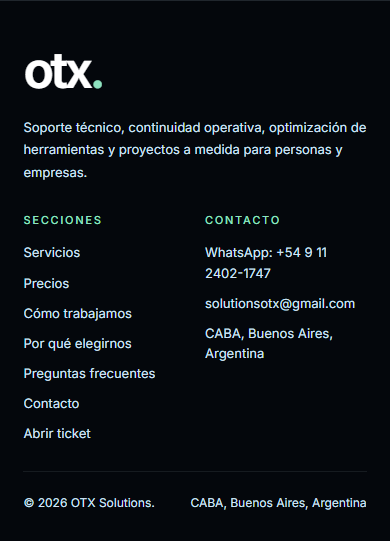 |
