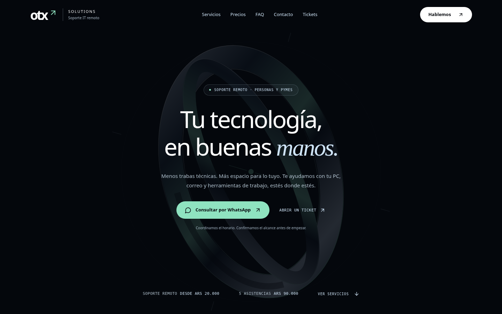
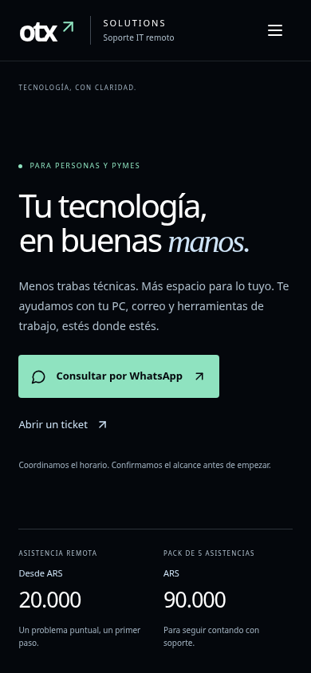

# OTX Solutions · Propuesta de portada A, revisión Obsidian

> Versión anterior. La propuesta vigente para aprobación es [Portada V2](PORTADA_V2.md).

Variante de header y portada sobre `mejora-comercial-2026-10`, para el PR #1. El rediseño de las demás secciones queda pendiente de aprobación visual. No se hizo merge ni despliegue.

## Dirección visual y recursos

Fondo `#04070C`, azul hielo `#CFE4F7`, verde suave `#8FE3C0` y blanco. Composición editorial centrada, badge discreto, CTA redondeados y franja inferior de precios sin tarjetas. Tipografía existente combinada con serif y monospace del sistema, navegación mínima y una ilustración SVG original en el fondo. No hay video, canvas, WebGL ni nuevas dependencias de la aplicación.

El prompt de Obsidian/Kolpu fue recibido como referencia visual, no como especificación literal. Se conservaron copys y precios de OTX, el scroll del documento y todas sus secciones. No se copiaron textos sobre ciberseguridad, certificaciones ni estadísticas.

Se intentó consultar `https://kolpusites.com`, `https://www.kolpusites.com`, `https://kolpusites.com/terms` y `https://kolpusites.com/license`: el acceso devolvió `403 Forbidden` desde el entorno. No fue posible verificar una licencia comercial del video `media.kolpusites.com/obsydian/obsedian%20background%20video.mp4`. Por eso no se descargó ni incorporó. Tampoco se incorporaron recursos tipográficos nuevos de Fontshare/Google. No se afirma que Kolpu carezca de licencia: su permiso de reutilización no pudo comprobarse.

Se conserva el SVG creado para OTX como alternativa original y estática, sin reproducción multimedia. Los iconos provienen de la dependencia Lucide ya existente.

La entrada de la ilustración dura 0,9 segundos; `prefers-reduced-motion: reduce` la desactiva y elimina el scroll animado. En móvil se reduce la opacidad del gráfico de fondo y se priorizan texto, CTA y precios.

## Vista previa

### Escritorio · 1440 × 900

### Móvil · 390 × 844

La portada ocupa el primer viewport en estos tamaños. Con pantallas más pequeñas, orientación horizontal o contenido ampliado puede crecer: el documento conserva el scroll natural. Servicios, Precios, FAQ, Contacto y la ruta `/ticket` continúan disponibles.

## Alcance funcional

- WhatsApp como CTA principal; Tickets como alternativa.
- Asistencia desde ARS 20.000 y pack de cinco por ARS 90.000 en la portada.
- Se conserva la condición existente para mostrar Mercado Pago únicamente con enlace configurado y válido. No se agregó ningún enlace de cobro.
- Sin certificaciones, métricas ni testimonios en la portada nueva.
- Menú móvil con estado accesible, cierre por Escape, retorno del foco, cierre al navegar y al pulsar fuera. Sin bloquear el scroll del documento.
- Enlace para saltar al contenido, foco visible, iconos decorativos ocultos a lectores y lenguaje del documento corregido a `es-AR`.
- Fuera de la portada, solo se ajustaron dos clases de tamaño y la posición de la tarjeta de WhyUs para corregir desbordamientos previos en móvil; no se rediseñó esa sección.

## Validación realizada

Compilación de producción con Node 24: `REACT_APP_BACKEND_URL=http://127.0.0.1:8001 npm --prefix frontend run build` (correcta). `git diff --check` correcto.

Playwright + Chromium: 1920×1080, 1440×900, 1366×768, 1280×720, 768×1024, 390×844, 375×667, 320×740, 844×390 y 2560×1440. En los diez tamaños: sin desbordamiento horizontal ni errores JS, scroll funcional y secciones conservadas. Menú móvil, Escape, retorno del foco y navegación comprobados. Reducción de movimiento comprobada. Resultados: [checks.json](preview/checks.json).

Axe, limitado a header y portada: **0 infracciones automáticas** en los diez tamaños, con reglas WCAG 2 A/AA, 2.1 A/AA, 2.2 AA y buenas prácticas. No sustituye una evaluación manual completa con tecnologías de asistencia. Compatibilidad móvil validada por emulación en Chromium, no por dispositivos iOS/Safari reales.

Lighthouse móvil sobre la compilación completa, servido localmente sin compresión ni caché de producción:

| Medida | Base de la rama | Variante |
| --- | --- | --- |
| Rendimiento | 65/100 | 67/100 |
| Accesibilidad global | 92/100 | 92/100 |
| LCP | 4,7 s | 4,7 s |
| TBT | 680 ms | 600 ms |
| CLS | 0 | 0 |

Son mediciones de laboratorio, no métricas reales de usuarios. El rendimiento general todavía requiere optimización. El bundle final pesa aproximadamente 150,74 kB JS y 12,23 kB CSS con gzip; la portada no incorpora descargas multimedia.

## Pendientes fuera de esta propuesta

- Aprobar esta dirección antes de rediseñar otras secciones.
- La auditoría de la página completa conserva fallos anteriores: pestañas de precios sin nombre accesible en móvil y contraste insuficiente en WhyUs, Footer y Contacto. No se afirma conformidad global de accesibilidad.
- WhyUs y Footer todavía contienen afirmaciones históricas no verificadas (experiencia, casos, satisfacción y respuesta). No se reutilizaron en la portada; deben retirarse o verificarse al revisar esos contenidos.
- Persisten textos anteriores fuera de la portada, como la etiqueta de pack a ARS 220.000 en Contacto, aunque el valor interno y Precios usan ARS 90.000. No se extendió esta variante al formulario.
- No se enviaron tickets reales ni se probó cobro de Mercado Pago; no forman parte de la validación visual.
