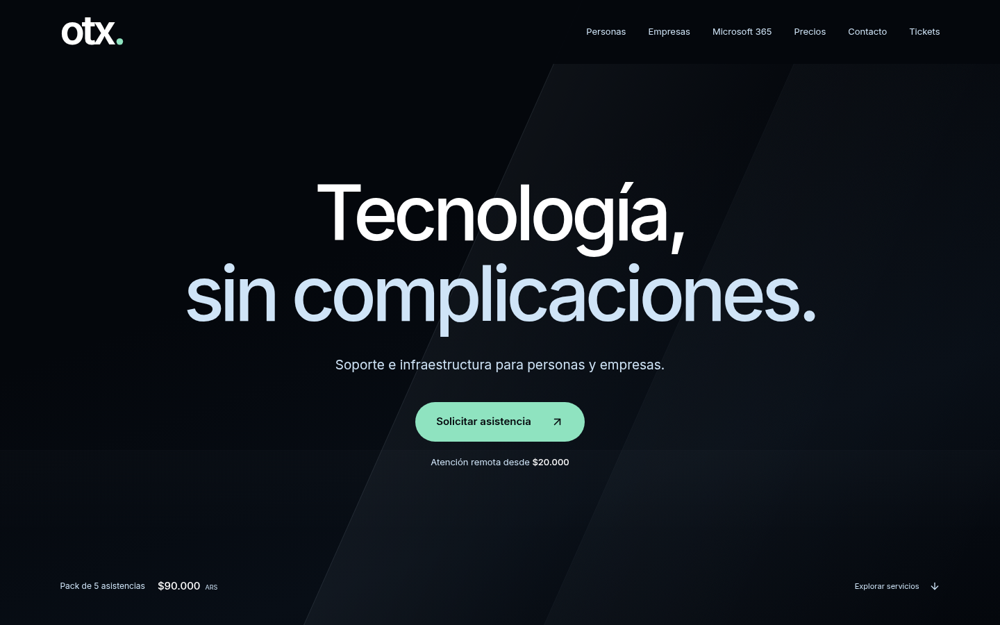
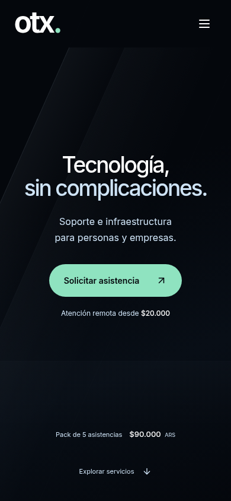

# otx. — Portada V2

Segunda versión visual en `mejora-comercial-2026-10`, PR #1. **Pendiente de aprobación visual. Sin merge ni despliegue.**

## Propuesta

Marca `otx.` y titular protagonista: **Tecnología, sin complicaciones.** Subtítulo: **Soporte e infraestructura para personas y empresas.** Un solo CTA dominante: **Solicitar asistencia**, que abre WhatsApp con un mensaje de solicitud a OTXSolutions.

Atención remota desde **$20.000** bajo el CTA; pack de cinco por **$90.000 ARS** en la base. Navegación directa a Personas, Empresas, Microsoft 365, Precios, Contacto y Tickets. Las tres categorías abren sus pestañas correspondientes; Servicios sigue accesible desde la portada. Se conserva el desplazamiento natural.

Se eliminó por completo el SVG decorativo. El fondo es una composición original de planos oscuros y luz lateral tenue hecha con CSS. Usa únicamente matices derivados de `#04070C`, `#CFE4F7`, `#8FE3C0` y blanco. No usa video, imágenes, canvas, filtros de desenfoque, partículas ni animaciones. No contiene recursos de Kolpu.

### Captura real de escritorio · 1440 × 900

### Captura real de móvil · 390 × 844

Son capturas de Playwright de la compilación de producción, con la fuente cargada; no son renders ni maquetas. La V1 queda conservada en [su documento](PORTADA_PREMIUM.md) y en el historial Git.

## Alcance de cambios

- Rediseño visual limitado a Header, Hero y sus estilos.
- «OTXSolutions» se conserva en metadatos y nombre accesible de la marca.
- Se utiliza «Empresas» en etiquetas comerciales; los identificadores internos `pymes` y el enum de API `pyme` se conservan por compatibilidad.
- Etiquetas de Contacto corregidas de $50.000/$220.000 a $20.000/$90.000. Tickets corregido de $15.000/$65.000 a los mismos importes. Opciones empresariales alineadas con el catálogo vigente ($120.000/$180.000), sin cambiar sus valores; se retiró la opción mensual antigua que no figura en ese catálogo.
- Pestañas de precios con nombres accesibles en móvil y un evento de selección explícito para la nueva navegación. Se mantienen las interacciones manuales de las pestañas. El botón existente «Ver planes M365» también usa esa selección explícita: antes buscaba un atributo que no estaba presente en el DOM.
- No se rediseñaron Servicios, Precios, FAQ, Contacto, Tickets ni Footer; solo se corrigieron etiquetas y la nomenclatura indicada. Se conserva la condición existente de Mercado Pago: requiere enlace válido configurado. No se agregó enlace de pago ni se enviaron tickets reales.
- No se añadieron métricas, certificaciones, clientes ni testimonios.

## Tipografía y licencia

Inter, ya elegida por el proyecto, ahora se sirve localmente: una fuente variable WOFF2 Latin de unos **48 kB**, con precarga y `font-display: swap`. Se elimina la importación remota bloqueante de Google Fonts. No se agregaron dependencias de ejecución ni paquetes de pago.

Origen: `@fontsource-variable/inter@5.2.8` (registro npm, verificación de integridad normal del gestor). La **SIL Open Font License 1.1** permite uso comercial, incrustación y redistribución conservando los avisos. La licencia y el copyright se incluyen en [Inter-OFL.txt](../frontend/public/fonts/Inter-OFL.txt); la fuente se distribuye sin modificar. Esto no implica permiso para los recursos de Kolpu, que no se utilizan.

## Verificaciones

- Node 24: `REACT_APP_BACKEND_URL=http://127.0.0.1:8001 npm --prefix frontend run build`, correcto. `git diff --check`, correcto.
- Chromium/Playwright: 320×740, 375×667, 390×844, 768×1024, 844×390, 1280×720, 1366×768, 1440×900, 1920×1080 y 2560×1440. Sin desbordamiento horizontal ni errores JS; todas las secciones conservadas, scroll libre y menú móvil funcional. En horizontal bajo la portada crece para no recortar contenido.
- Escape, retorno de foco y cierre al navegar comprobados. Fondo sin movimiento; reducción de movimiento respetada.
- Axe sobre header y portada: **0 infracciones automáticas** en los diez tamaños, con reglas WCAG 2 A/AA, 2.1 A/AA, 2.2 AA y buenas prácticas. No equivale a certificación de accesibilidad.
- En escritorio y móvil: destino y mensaje de WhatsApp, navegación a las tres categorías, ruta de Tickets y etiquetas reales de precios de los selects de Contacto y Tickets comprobados sin enviar formularios.
- Resultados: [responsive y accesibilidad](preview-v2/checks.json), [enlaces y precios](preview-v2/links-v2.json).

Lighthouse móvil sobre la página completa, compilación local sin compresión/caché de producción:

| Medida | V1 | V2 |
| --- | --- | --- |
| Rendimiento | 67/100 | **75/100** |
| Accesibilidad global | 92/100 | 92/100 |
| FCP | 1,8 s | 1,1 s |
| LCP | 4,7 s | 4,4 s |
| TBT | 600 ms | 410 ms |
| CLS | 0 | 0 |

Mediciones puntuales de laboratorio, sujetas a variación; no son métricas reales de visitantes. Queda margen para optimizar el resto de la aplicación. Bundle final: unos 149,90 kB JS y 11,86 kB CSS con gzip, más la fuente local.

## Límites y siguiente paso

Aprobar visualmente esta V2 antes de ampliar el rediseño. No se validó con dispositivos iOS/Safari físicos; la revisión móvil corresponde a viewports de Chromium.

La auditoría global conserva problemas anteriores de nombres accesibles en selectores de Contacto y contraste en WhyUs, Contacto y Footer. También permanecen afirmaciones históricas no verificadas fuera de la portada. No se presenta el sitio completo como plenamente accesible ni se avalan esas afirmaciones; su revisión pertenece a la próxima etapa.
