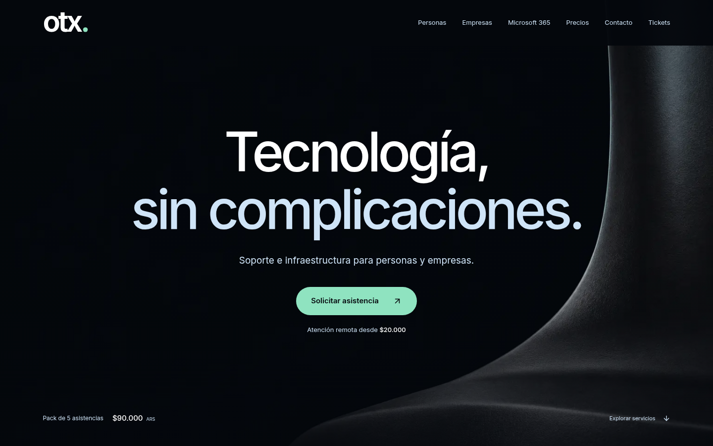
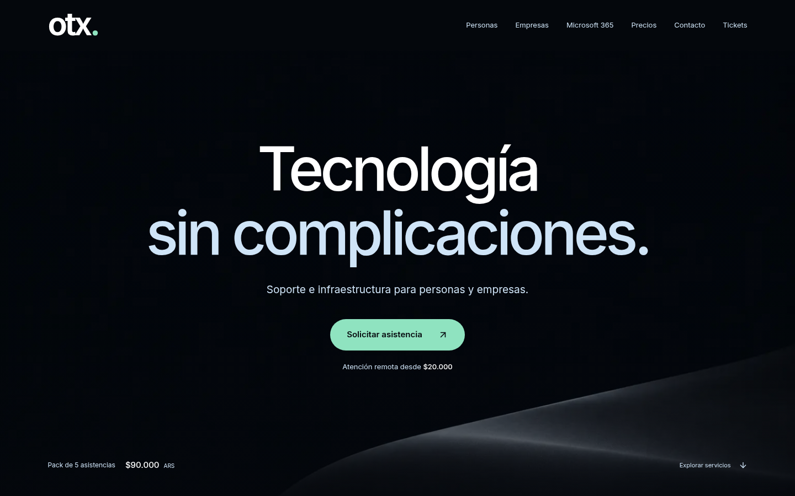
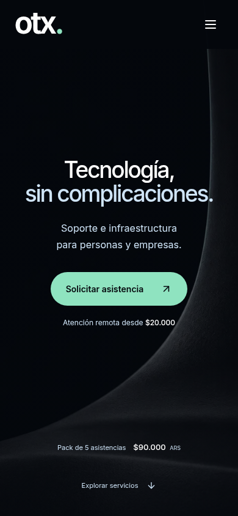
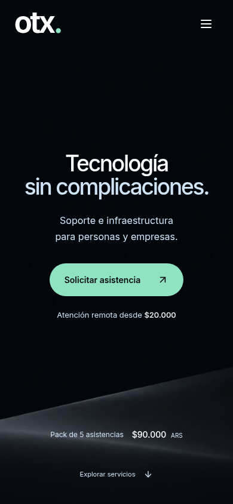

# Refinamiento de V3 — otx.

Ajuste puntual en el PR #1, sobre `mejora-comercial-2026-10`. No es una nueva estructura de portada. Sin merge ni despliegue.

## Comparación visual real

### Escritorio · 1440×900

| V3 | Refinamiento |
| --- | --- |
|  |  |

### Móvil · 390×844

| V3 | Refinamiento |
| --- | --- |
|  |  |

Capturas reales de ambas compilaciones, con la fuente y el fondo cargados. La V3 anterior queda conservada para comparar, no se sobrescribieron sus capturas.

## Qué cambió

- H1: **Tecnología sin complicaciones.** Se elimina únicamente la coma; se mantienen los dos spans, el salto visual en dos líneas, los tamaños y los colores.
- Fondo: se reemplaza el volumen alto y su borde vertical por un relieve bajo de grafito satinado, situado en la zona inferior. El reflejo azul hielo es tenue y el centro queda despejado. Se reduce el grano marcado que podía sugerir tela. Sin humo, partículas, nebulosas, resplandores emisivos ni animación.
- Precios: en móvil, el texto de atención remota pasa de 12 a 13 px, con 2 px más de margen respecto al botón. El rótulo del pack pasa de 11 a 12 px, el importe de 13 a 14 px y ARS de 9 a 10 px. Se separan ligeramente rótulo e importe. El espacio entre el pack y «Explorar servicios» pasa a 22 px, también en móviles de poca altura. No cambian los importes ni las etiquetas.

No se modifican Header, logo, CTA, navegación, servicios, formularios ni funcionalidades. La tipografía principal y la paleta siguen intactas. En el código de Hero, la única modificación de contenido es la coma del H1. Los demás cambios de aplicación se limitan a los estilos indicados y a las dos imágenes de fondo.

## Recurso visual

Edición generada originalmente para esta tarea a partir del recurso original de V3; no es fotografía documental ni un activo de Kolpu o de biblioteca. Se conserva el archivo fuente generado fuera del checkout y se distribuyen las variantes WebP estáticas optimizadas. No se añaden dependencias ni descargas externas.

| Imagen | V3 | Refinamiento |
| --- | --- | --- |
| Escritorio, 1536×1024 | 27.990 bytes | 7.246 bytes |
| Móvil, 640×1024 | 25.250 bytes | 4.158 bytes |

El recurso móvil pesa aproximadamente **84% menos**. Se carga una sola variante según el viewport; el fondo sólido y el velo mantienen legibilidad mientras carga la imagen.

## Validación

- Build de producción correcto con Node 24: `REACT_APP_BACKEND_URL=http://127.0.0.1:8001 npm --prefix frontend run build`. `git diff --check`, correcto.
- Chromium/Playwright: 320×740, 375×667, 390×844, 768×1024, 844×390, 1280×720, 1366×768, 1440×900, 1920×1080 y 2560×1440. Sin desbordamiento horizontal ni errores JS; scroll, menú móvil, Escape y retorno del foco comprobados.
- Comparación contra una captura de datos de la V3 previa: marca, paleta, enlaces, tipografía principal, dimensiones de H1/CTA y resto de los textos conservados en los diez tamaños. Se registran los pequeños desplazamientos esperados por la nueva separación de precios: [comparison-check.json](preview-v3-refined/comparison-check.json).
- Axe en header y portada: 0 infracciones automáticas en los diez tamaños. No equivale a certificar toda la web.
- Contraste medido sobre píxeles del fondo renderizado en escritorio/móvil, usando el punto más claro de cada caja de texto: mínimo **6,43:1** (V3: 6,16:1). Título y subtítulo quedan sobre la zona oscura; se conservan los colores opacos del CTA. [Resultados](preview-v3-refined/contrast-check.json).
- [Comprobaciones responsive](preview-v3-refined/checks.json).

La revisión móvil usa viewports de Chromium, no dispositivos Safari/iOS físicos. Los pendientes de accesibilidad de las otras secciones no forman parte de este refinamiento.

## Rendimiento comparado

Para comparar sin elegir una corrida favorable, se recompiló la V3 del commit `0e1b9f7` con las mismas dependencias y se midieron **tres pasadas móviles alternadas por versión**, sin otras pruebas de navegador en paralelo. Ambas compilaciones se sirvieron localmente sin compresión/caché de producción. Se reportan medianas:

| Medida | V3 | Refinamiento |
| --- | --- | --- |
| Lighthouse, rendimiento | 74/100 | **76/100** |
| FCP | 1,05 s | 1,05 s |
| LCP | 4,61 s | 4,58 s |
| TBT | 386 ms | 335 ms |
| CLS | 0 | 0 |

Puntajes por pasada: V3 **72, 74, 76**; refinamiento **76, 70, 78**. Son mediciones de laboratorio sujetas a variación, no métricas reales de visitantes ni prueba de una mejora causal exacta de dos puntos. El nivel de rendimiento se conserva en esta comparación; la reducción comprobable de transferencia es el fondo móvil, aproximadamente 84% más liviano. La medición histórica única de V3 había dado 75/100.

Se retiró el ajuste opcional de cifras tabulares y se aisló el layout/pintado del nodo decorativo del fondo con `contain: strict`; no se cambió el renderizado de otras secciones ni se incorporaron dependencias. El bundle JavaScript mantiene unos 149,90 kB gzip. La auditoría global de accesibilidad conserva 92/100 y sus pendientes anteriores fuera de esta portada.

[Resultados completos de las seis pasadas](preview-v3-refined/performance-comparison.json).
