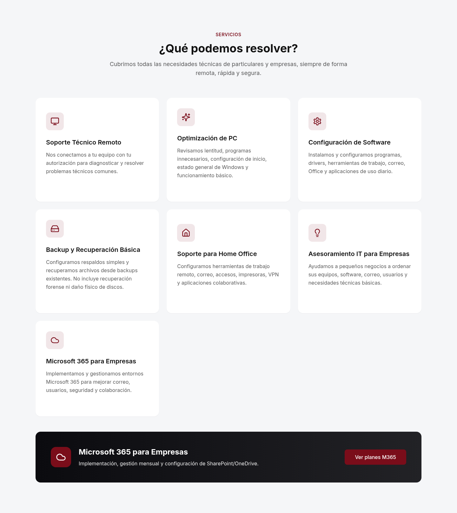
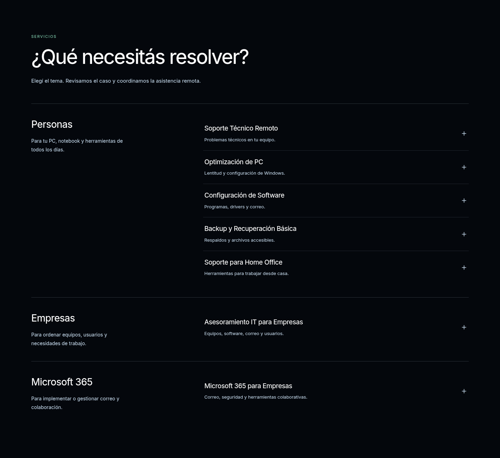
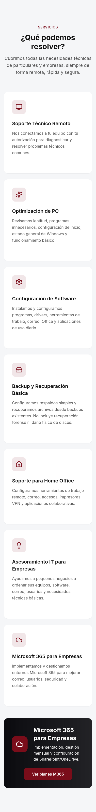
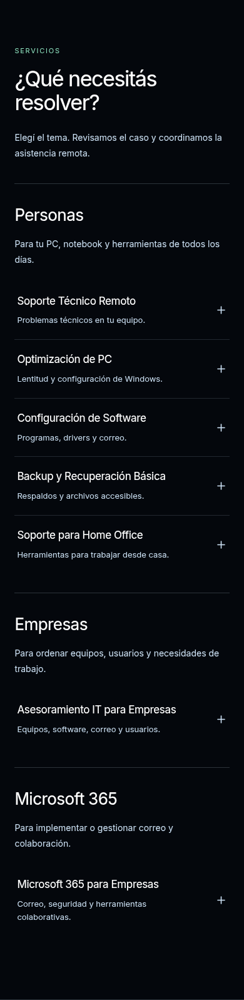
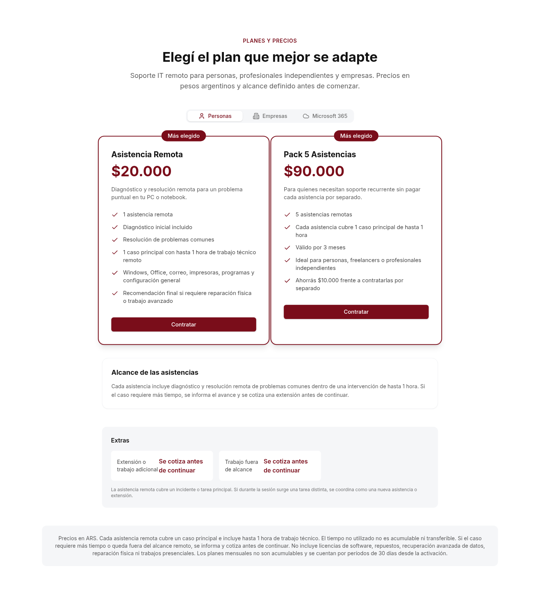
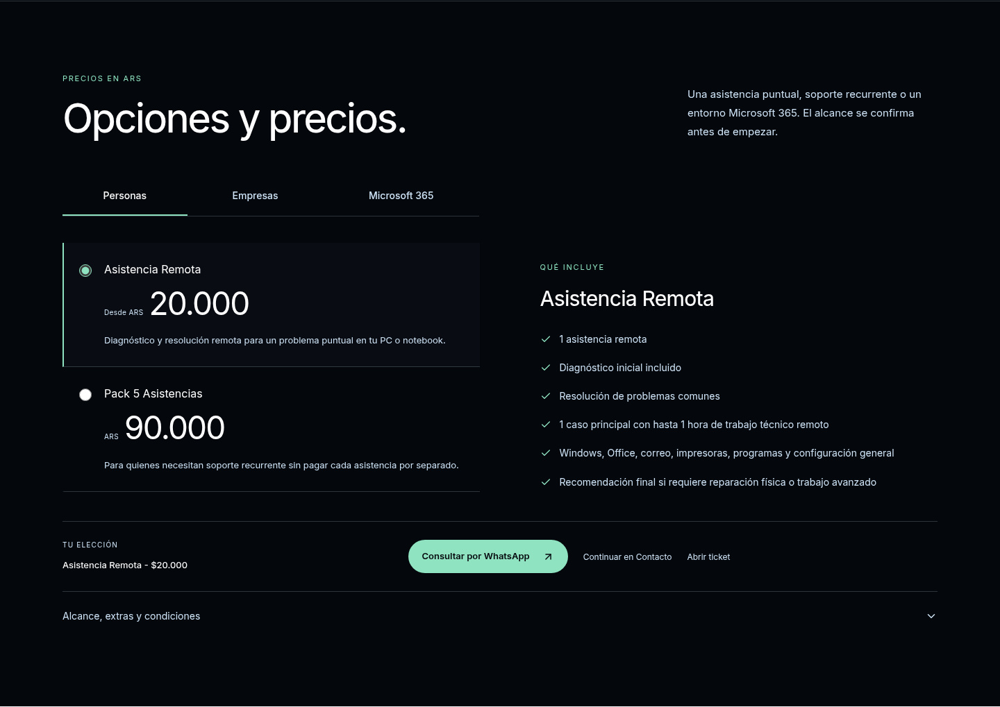
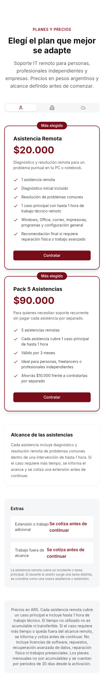
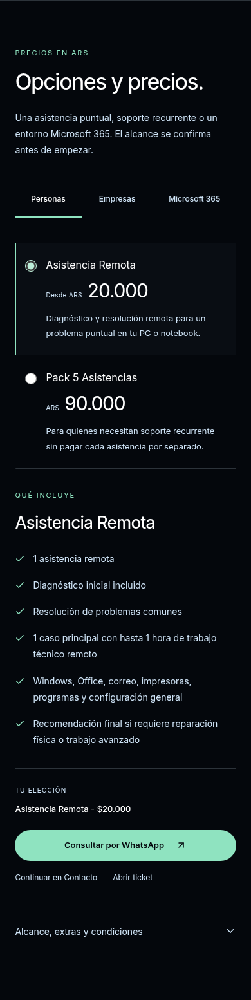

# Servicios y Precios — propuesta para revisión

Continuación del PR #1 en `mejora-comercial-2026-10`, sobre la portada aprobada del commit `76ebd57`. Sin merge ni despliegue.

## Comparación real: Servicios

| Antes · escritorio | Propuesta · escritorio |
| --- | --- |
|  |  |

| Antes · móvil | Propuesta · móvil |
| --- | --- |
|  |  |

Las siete prestaciones vigentes se agrupan en Personas, Empresas y Microsoft 365. Las filas indican el tema y el caso de uso; al abrir una se ve el alcance original y las acciones para continuar. Se abre una sola fila a la vez. Su contenido se monta únicamente al abrirla para evitar trabajo inicial innecesario.

Estado abierto: [escritorio](preview-offers/after-service-open-desktop.png) · [móvil](preview-offers/after-service-open-mobile.png).

## Comparación real: Precios

| Antes · escritorio | Propuesta · escritorio |
| --- | --- |
|  |  |

| Antes · móvil | Propuesta · móvil |
| --- | --- |
|  |  |

Otras categorías: Empresas [antes en escritorio](preview-offers/before-prices-pymes-desktop.png) / [antes en móvil](preview-offers/before-prices-pymes-mobile.png), después [escritorio](preview-offers/after-prices-pymes-desktop.png) / [móvil](preview-offers/after-prices-pymes-mobile.png); Microsoft 365 [antes en escritorio](preview-offers/before-prices-m365-desktop.png) / [antes en móvil](preview-offers/before-prices-m365-mobile.png), después [escritorio](preview-offers/after-prices-m365-desktop.png) / [móvil](preview-offers/after-prices-m365-mobile.png).

Son recortes de secciones de las compilaciones locales, con las fuentes cargadas. Se oculta el header fijo únicamente durante esos recortes para no tapar su contenido; el header de la aplicación permanece intacto.

## Diseño y oferta

- Estética oscura con la paleta aprobada: `#04070C`, `#CFE4F7`, `#8FE3C0` y blanco. Estilos limitados a `.otx-offer`, sin nuevas imágenes, fuentes o dependencias.
- Se sustituyen las grillas de tarjetas por filas de servicio y una selección de planes mediante radios nativos. Se muestran las inclusiones de la opción elegida y una única acción verde principal para esa elección. No se muestran badges de popularidad no verificados.
- WhatsApp es la acción principal, con servicio o plan incluido en el mensaje. Contacto y Tickets son alternativas secundarias.
- Categorías de precios siempre rotuladas, también en móvil. Se conserva el evento del header para Personas, Empresas y Microsoft 365.
- Asistencia desde ARS 20.000 y pack de cinco por ARS 90.000 visibles. Se conservan los importes empresariales ARS 120.000/mes, ARS 180.000/mes y A cotizar; Microsoft 365 desde ARS 85.000, ARS 25.000/mes y ARS 45.000. Extras, inclusiones, vigencias y condiciones se siguen leyendo del catálogo original, que no se modificó.
- Alcance, extras y condiciones quedan en un desplegable nativo por categoría. Se conserva el texto de límites de horas, casos, puestos, vigencias, no acumulación y licencias. No se inventan prestaciones ni tiempos de respuesta.

## Portada y alcance protegido

Header, Hero, `PremiumIntro.css`, fondo y fuentes aprobados no se modificaron. Las capturas completas del primer viewport son idénticas píxel por píxel antes/después en escritorio y móvil. [Comprobación](preview-offers/intro-preservation.json).

No se rediseñaron FAQ, Contacto, Tickets, Footer, Cómo funciona ni WhyUs. El archivo de datos del catálogo conserva sus valores exactos.

Hay una integración mínima en Contacto y Tickets: ambos selectores de planes usan la misma lista derivada del catálogo, conservando la opción genérica anterior de Microsoft 365. Esto permite mostrar los planes específicos seleccionados y Empresa Plus, que antes podían quedar sin etiqueta. Los selectores y sus menús contienen los nombres largos dentro del viewport; no se cambia el estilo de los formularios. «Continuar en Contacto» lleva al primer campo del formulario, con foco y separación respecto al header fijo.

## Validación

- Build correcto con Node 24: `REACT_APP_BACKEND_URL=http://127.0.0.1:8001 npm --prefix frontend run build`. `git diff --check`, correcto.
- Chromium/Playwright: 320×740, 375×667, 390×844, 768×1024, 844×390, 1280×720, 1440×900 y 1920×1080.
- Axe en Servicios y Precios: 0 infracciones automáticas en 24 estados de categoría/viewport y las comprobaciones de servicio abierto. Condiciones desplegadas y sin desbordamiento horizontal.
- Teclado: Enter abre el servicio; las flechas cambian categorías y opciones; foco visible y respeto de reducción de movimiento. Los seis accesos de categorías del header (tres en escritorio y tres en móvil) seleccionan sus pestañas.
- 30 recorridos de selección: ocho planes y siete servicios, cada uno en escritorio y móvil. Se verifica el mensaje de WhatsApp, el valor y asunto de Contacto, y la selección al abrir Tickets. Sin enviar formularios ni mensajes reales. Se verificó también el ancho después de seleccionar nombres largos y al abrir el menú de planes en móvil.
- Mercado Pago: ocho casos de validación de URL (incluidos HTTP, dominios falsos, credenciales y puertos no estándar). En la compilación normal no hay enlace sin configurar. Una compilación de prueba aislada confirma que aparece con una URL HTTPS válida de prueba solo para la asistencia individual, y desaparece al seleccionar el pack o Microsoft 365. No se configuró ningún enlace de cobro real ni se navegó a un pago.

Resultados: [accesibilidad y responsive](preview-offers/a11y-checks.json) · [recorridos de selección](preview-offers/flow-checks.json).

La revisión móvil corresponde a viewports de Chromium, no a dispositivos Safari/iOS físicos. La auditoría no certifica toda la web: persisten los pendientes anteriores de las secciones que no se rediseñaron. El envío real de tickets y los cobros no forman parte de estas pruebas.

## Rendimiento móvil comparado

Se recompiló la versión aprobada `76ebd57` con las mismas dependencias y se alternaron tres pasadas de Lighthouse móvil por versión, en la misma máquina, sin otras pruebas de navegador en paralelo. Servidores HTTP locales sin caché/compresión de producción. Medianas:

| Medida | Versión aprobada | Servicios y Precios |
| --- | --- | --- |
| Rendimiento | 74/100 | **78/100** |
| FCP | 1,06 s | 1,05 s |
| LCP | 4,61 s | 4,56 s |
| TBT | 395 ms | 300 ms |
| CLS | 0 | 0 |

Puntajes individuales: aprobada **74, 76, 69**; nueva **78, 71, 78**. Son resultados de laboratorio sujetos a variación; no representan métricas de visitantes ni garantizan una mejora causal exacta de cuatro puntos. La auditoría global de accesibilidad conserva 92/100 por los pendientes de otras secciones; el resultado de Axe sobre las dos secciones rediseñadas es cero infracciones.

Bundle final: aproximadamente **148,46 kB JS** y **12,81 kB CSS** con gzip, frente a 149,90 kB JS y 11,91 kB CSS en la versión aprobada. No se añaden imágenes ni otras descargas de interfaz. Los controles de servicio cerrados no montan sus enlaces hasta abrirse.

[Resultados completos de las seis pasadas](preview-offers/performance-comparison.json).

## Revisión pendiente

Aprobar visualmente estas dos secciones antes de continuar con otras. No se hizo merge ni se desplegó a producción.
